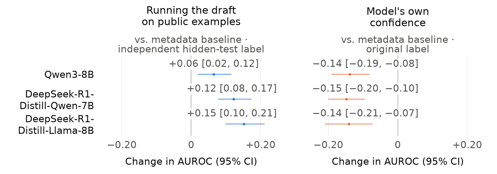
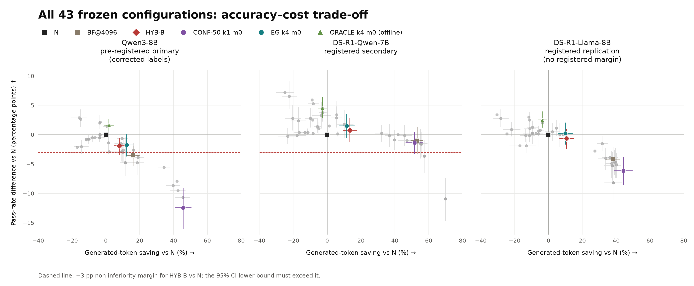
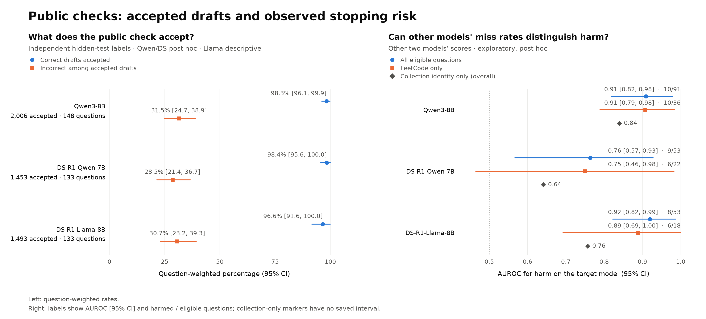
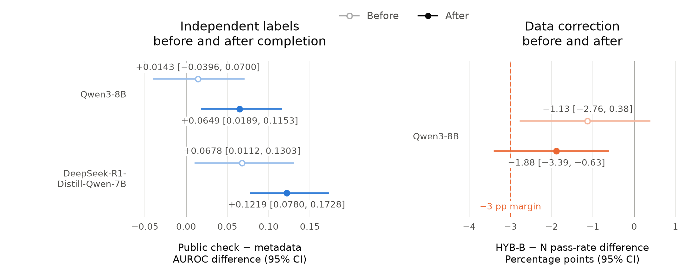

# ExecExit

English · [简体中文](README.zh-CN.md)

**Can running draft programs on public examples tell a reasoning model when to stop?**

Independent research project · 3 open-source reasoning models · 199 held-out coding problems

[What I found](#what-i-found) · [Why stopping fails](#why-a-good-signal-still-stops-unsafely--exploratory) · [Two turning points](#two-moments-that-changed-my-conclusions) · [What I built](#what-i-built) · [Technical report](docs/execexit/REPORT.md)

<a id="tldr"></a>

## Summary

Reasoning models often keep thinking after they have already written a working program. The question I studied is whether running each intermediate draft on the problem's public examples can tell the model when to stop.

- **The signal is informative.** On each of three open-source reasoning models, across 199 held-out problems, the public-example check identifies correct drafts better than a metadata baseline that knows only the problem's difficulty, the tokens used so far, and the draft's position: AUROC gains of +0.06 to +0.15 (AUROC measures how well correct drafts are ranked above incorrect ones; 0.5 is chance). The model's own confidence, by contrast, falls below the baseline (−0.14 to −0.15).
- **Stopping on it was not shown to be safe.** My pre-registered rule saved 7.9% of generated tokens. Accuracy fell significantly, by 1.9 percentage points (95% CI −3.4 to −0.6, excluding 0); the lower bound crosses the pre-set −3-percentage-point margin, so non-inferiority was not established. A latency improvement was not established either.
- **Failure mode (exploratory).** The check almost never rejects a correct draft (it accepts 97–98% of them), but about 30% of the drafts it accepts are wrong, and the stopping rule delivers those wrong programs directly. In addition, ranking problems by the *other* two models' miss rate on the same problem (the fraction of incorrect drafts that pass the public examples) picks out the problems where early stopping lowers the target model's average pass rate (AUROC 0.76–0.92).

My contribution is a controlled comparison: I test three things separately (recognizing a correct draft, stopping on it safely, and saving time), and I found and fixed [two issues in the labels and data that affect the conclusions](#two-moments-that-changed-my-conclusions). On the engineering side, I built the study's pipelines for draft extraction and sandboxed execution, offline policy replay, and paired-bootstrap statistics; the earlier work that led to this question was a BPE tokenizer, Transformer training, and an inference engine with a rollback-capable KV cache, all implemented from scratch ([What I built](#what-i-built)).

<picture>
  <source media="(prefers-color-scheme: dark)" srcset="docs/execexit/figures/signal_quality_3models_dark.png">
  
</picture>

**Figure 1.** AUROC difference from the metadata baseline (problem difficulty, tokens used so far, draft position); dots are estimates and lines are 95% confidence intervals. The left panel is scored on the independent hidden-test label and the right on the original label, each against its own baseline.

[Values and sources](runs/readme_figure/values.json) · [Plotting script](docs/execexit/render_results.py)

<a id="the-question"></a>

## The question

Reasoning models write a long chain of thought before giving a final answer. On coding problems, I can pause the model at a checkpoint and have it write out a complete program, which I call a *draft*. If a draft is already correct, every token after it is wasted. Code offers a check that most tasks lack: the public examples in the problem statement can actually be run.

I break "can the public-example check tell us when to stop?" into four questions, each building on the last, which the four findings below answer in order:

1. **Is there anything to save?** Has a correct draft already been written before reasoning ends?
2. **Can we recognize it?** Does the public-example check identify correct drafts better than model confidence and simple metadata?
3. **Is stopping on it safe?** Does the program delivered early still pass the hidden tests?
4. **Can it be faster?** Can the token savings turn into shorter end-to-end delivery time?

<a id="how-i-evaluated-it"></a>

## How I evaluated it

| | Approach |
|---|---|
| **What counts as success** | The complete program delivered to the client passes the hidden tests; every rejected probe and every fallback is counted as cost |
| **When the rules are fixed** | The hypotheses, the 3-percentage-point margin, and all 43 policy configurations were fixed before any held-out results existed; no configuration was dropped for performing poorly |
| **Uncertainty** | Paired problem-level bootstrap (10,000 resamples, every problem weighted equally), plus a strict criterion on the number of harmed problems |
| **Label independence** | Hidden-test labels, excluding any test whose input is identical to a public example |
| **Speed** | A separate end-to-end serving experiment |

**Setup.**
- **Models:** Qwen3-8B (primary), DeepSeek-R1-Distill-Qwen-7B (registered secondary), and DeepSeek-R1-Distill-Llama-8B (registered replication).
- **Problems:** 199 held-out problems: 126 previously unused LiveCodeBench v6 problems (63 AtCoder, 63 LeetCode) and 73 LiveCodeBench Pro problems from Codeforces.
- **Samples:** 650 sampled reasoning runs per model.

**Evidence levels.**
- **Pre-registered:** fixed before any held-out results existed.
- **Registered replication:** fixed in a later supplementary registration, before that model's results existed.
- **Post hoc / exploratory:** planned only after the relevant results were known.

<a id="what-i-found"></a>

## What I found

### 1. There is real room for savings · *Pre-registered*

In 304 of Qwen3-8B's 650 runs, some draft written before reasoning ended could already pass the tests. An oracle that knows the test results and picks the cheapest passing option among the recorded drafts and the native answer would save 14.8% of generated tokens (95% CI 11.7–18.2); for DeepSeek-R1-Distill-Qwen-7B the figure is 13.1% (9.8–16.8). This is an upper bound that charges nothing for unused probes and checks. [Details](docs/execexit/REPORT.md#c1-earlier-passing-drafts-create-a-bounded-opportunity)

### 2. The execution signal beats the metadata baseline; confidence falls below it · *Partly post hoc*

If execution results carry information, they should beat a baseline that knows only difficulty, tokens used so far, and draft position. Relative to this baseline, the public-example check gains +0.06, +0.12, and +0.15 AUROC on the three models, while confidence loses 0.14, 0.15, and 0.14 (Figure 1). The advantage is not uniform: for Qwen3-8B, the intervals on AtCoder and LeetCode include 0, and the gain is largest on LiveCodeBench Pro. The public-example check is post hoc for the first two models and a registered replication for the third ([why](#two-moments-that-changed-my-conclusions)). [Details](docs/execexit/REPORT.md#c2-confidence-execution-and-the-metadata-baseline)

### 3. A better signal did not yield a safe stopping rule · *Pre-registered primary test*

The registered rule (HYB-B) checks drafts on a fixed schedule within the first 4,096 tokens and delivers the first complete draft that passes the public examples; if none passes, it continues native reasoning. The pre-specified margin: an accuracy loss of no more than 3 percentage points relative to native generation (a non-inferiority test).

- **Results on Qwen3-8B:**
  - It saved 7.9% of tokens (5.0–11.1), and accuracy fell by 1.9 percentage points (−3.4 to −0.6). The interval excludes 0, so the drop is real; it also crosses −3, so non-inferiority was not established.
  - Eleven of the 199 problems were harmed, all of them LeetCode problems. A problem counts as harmed if, in at least one sampled run, native generation passed while the program delivered by early stopping in that same run failed. The strict criterion requires the one-sided 97.5% upper confidence bound on the share of harmed problems to be below 3%; the actual upper bound was 9.7%.
  - In the second registered comparison, against simply forcing an answer at 4,096 tokens, it was +1.6 percentage points higher (−0.5 to +3.8) but used 9.8% more tokens. This advantage was not established either.
- **On the other two models** (secondary results): DeepSeek-R1-Distill-Qwen-7B shows +0.8 percentage points (−1.1 to +2.8) with 13.4% saved, meeting nominal non-inferiority but failing the stricter harm criterion (10 of 199 problems harmed); DeepSeek-R1-Distill-Llama-8B (no pre-specified criterion) shows −0.6 percentage points (−2.4 to +0.9) with 10.7% saved.

[Details](docs/execexit/REPORT.md#c3-the-stopping-policy-did-not-establish-the-primary-claim)

<picture>
  <source media="(prefers-color-scheme: dark)" srcset="docs/execexit/figures/pareto_43_dark.png">
  
</picture>

**Figure 2.** All 43 frozen configurations on each of the three models, each relative to native generation (N): further right saves more, higher up is more accurate. Gray points are the remaining configurations; error bars are nominal 95% confidence intervals on both axes. HYB-B is the registered rule; BF@4096 forces an answer at 4,096 tokens; CONF-50 stops on the model's confidence; EG accepts the first draft that passes the public examples, with no 4,096-token cutoff; ORACLE is an offline reference that knows the hidden-test results and can't be deployed. k4 means every fourth candidate is checked, and m0 means checking starts from the beginning of reasoning. The dashed line is HYB-B's −3-percentage-point non-inferiority margin against N.

Cheaper signals save more, at a higher price: stopping on model confidence saves about 46% of tokens but loses 12.4 percentage points on Qwen3-8B (−16.0 to −9.2). [Data](runs/qwen_erratum/secondary_intervals43/raw/comparisons.jsonl)

### 4. Token savings did not translate into faster delivery · *Pre-registered*

In a separate serial serving experiment on 40 problems, the gated system's latency ratio relative to native generation was 0.983 (0.870–1.101), an interval that includes "no change." In actual serving, the gated system generated 3.7% more tokens in total than native generation (including aborted tails). [Details](docs/execexit/REPORT.md#c4-token-savings-did-not-establish-a-service-latency-improvement)

<a id="why-a-good-signal-still-stops-unsafely--exploratory"></a>

## Why a good signal still leads to unsafe stopping · *Exploratory*

Ranking drafts well on average is not the same as never accepting a wrong one. Almost all of the check's errors are wrong drafts it lets through: on the independent hidden-test labels, it accepts 98%, 98%, and 97% of correct drafts, but 31%, 29%, and 31% of the drafts it accepts are wrong (weighted by problem; Qwen3, DeepSeek-Qwen, DeepSeek-Llama). These rates are counted over drafts; they are not the error rates of the answers a policy delivers. Once the stopping rule accepts a wrong draft that slipped past the public examples, it delivers a wrong answer. [Qwen3](runs/c2_label_completion/raw/qwen_completed/main/summary.json) · [DeepSeek-Qwen](runs/c2_label_completion/raw/ds_completed/main/summary.json) · [DeepSeek-Llama](runs/llama_execution_repair1/blind/analysis/results/private_c2.json)

For each problem, I measured the **miss rate**: the fraction of incorrect drafts that pass the public examples.

- **It follows the problem, not just the model.** Different models' miss rates on the same problem are positively correlated (Spearman ρ of 0.58–0.70 across the three model pairs). This could be because the problem's public examples are weak, or because the models make the same mistakes; for now, the two can't be told apart.
- **It doesn't reflect the number of public examples.** There is no consistent relationship between how many examples a problem has and its miss rate.
- **On existing problems, cross-model miss rates pick out the problems whose average pass rate drops.** For each target model, I rank problems by the pooled miss rate of the other two models and compute the AUROC for distinguishing whether early stopping lowered the target model's average pass rate on that problem (0.5 is chance). Only problems where the target model's native generation passed at least once and the other two models produced at least one incorrect draft are included.

"Harm" here means the per-problem average pass rate dropped, a different measure from the primary test, which is why Qwen3-8B shows 10/91 rather than 11/199; the "LeetCode only" and "collection identity only" results in the right panel of Figure 3 are checks I added after seeing the overall results.

<picture>
  <source media="(prefers-color-scheme: dark)" srcset="docs/execexit/figures/public_check_risk_dark.png">
  
</picture>

**Figure 3.** Left: the fraction of correct drafts accepted, and the fraction of accepted drafts that are wrong (weighted by problem). Right: AUROC for using the other two models' miss rates to distinguish problems where the target model's average pass rate dropped, computed over all eligible problems and over LeetCode only; diamonds mark the collection-identity-only reference.

On eligible existing problems, the other models' miss rates pick out the problems where the target model's average pass rate drops (AUROC 0.76–0.92), offline evidence for cross-model risk stratification; its causal source and generalization to new problems remain to be tested, which is the first follow-up question below. [Details](docs/execexit/REPORT.md#mechanism-public-test-strength-exploratory) · [Saved estimates](runs/public_test_strength/summary.json)

<a id="two-moments-that-changed-my-conclusions"></a>

## Two turning points that changed my conclusions

**1. My correctness label contained the very signal I was testing.**

Under the evaluation rule I originally registered, a draft counted as correct only if it passed both the public examples and the hidden tests. That made the public-example check part of its own target: it could never miss a correct draft, and part of its advantage over the baseline came from the definition itself. So I did three things:

- **Defined an independent label.** It uses only the hidden tests and drops any test whose input is identical to a public example. I wrote the definition down before computing anything.
- **Filled in the missing labels.** In the first computation, many labels were unknown, mainly because the original LeetCode test harness stopped at the first failing public example. On those incomplete labels, Qwen3-8B had not yet established an overall advantage. The missing labels were not random: every one belonged to a draft that had failed the public examples. So instead of discarding them, I filled them in, re-executing programs 2,867 times and running a timeout-sensitivity check. On the completed labels, the advantage holds for both models.
- **Registered the same test for a third model.** The decision to complete the labels was made after seeing the first results, so I treat the estimates for the first two models as post hoc. I then registered the same test before any results for the third model existed. The result replicated: +0.15 (0.10–0.21).

[Completion record](runs/c2_label_completion/final_counts.json) · [Registered replication](runs/llama_execution_repair1/blind/analysis/results/private_c2.json)

**2. A data correction flipped my primary result.**

The public example inputs extracted for LiveCodeBench Pro contained blank lines, which could make otherwise-correct programs that read input line by line fail. I checked all 78 examples across the 73 problems against the official Codeforces pages and corrected them. The correction was applied uniformly to every policy, and no model output was regenerated. Before the correction, the primary comparison passed the nominal non-inferiority test (−1.13 percentage points, −2.76 to +0.38); after it, the comparison failed (−1.88, −3.39 to −0.63). The reason is that the original label required passing the public examples: the defect caused 3 native runs that were actually correct to be judged as failures, which made it look as though the stopping rule had rescued them.

The same pattern, a program that fails the public examples yet passes every hidden test, also showed up on AtCoder (19 programs). I checked each one: all 19 were genuinely wrong, and the hidden tests just didn't catch them, so I did not extend the correction there. [Case study](docs/case_studies.md#a-data-defect-that-flipped-the-primary-result) · [AtCoder check](runs/atcoder_public_discordance/summary.json) · [Report](docs/execexit/REPORT.md#lcb-pro-public-input-defect-and-correction)

<picture>
  <source media="(prefers-color-scheme: dark)" srcset="docs/execexit/figures/turning_points_dark.png">
  
</picture>

**Figure 4.** Estimates before (hollow) and after (filled) each turning point. Left: the public-example check's AUROC gain over the metadata baseline on the independent label; "before" uses only the labels known at the time. Right: the primary pass-rate difference, with the −3-point non-inferiority margin dashed. [Values and sources](runs/readme_figure/values.json)

<a id="things-i-tried-that-didnt-work"></a>

## Things I tried that didn't work

- **Confidence-gated early exit (the pilot that led to this study).** On 36 development problems I had already seen, DEER-style confidence gating cut average delivery time from 110 seconds to 90, but the number of correctly delivered programs fell from 19 to 14: it rescued 1 problem and harmed 6. This pushed me toward external signals. [Pilot](docs/case_studies.md#evaluating-faster-code-generation) · [Saved results](runs/early_exit_pilot/summary.json)
- **Adding more checks beyond the public examples.** I tried adding self-generated stress tests, or requiring the draft to behave consistently with the previous one. Neither beat simply waiting for the second draft that passes the public examples: across 252 AtCoder runs, they passed 121 and 120 times respectively, versus 121 for the control, and at a higher token cost. [Details](docs/execexit/REPORT.md#policy-harm-and-public-false-acceptance)

<a id="what-i-built"></a>

## What I built

This study combines from-scratch foundations with an evaluation pipeline built for this question. The study's experiments run open-source models with vLLM.

| Component | What it demonstrates | Code |
|---|---|---|
| From-scratch language model | A BPE tokenizer, Transformer, AdamW, and training loop, built on the Stanford CS336 assignment. Streaming encoding matches whole-text encoding at every chunk boundary ([case study](docs/case_studies.md#streaming-tokenization-must-preserve-the-token-sequence)); checkpoints save the optimizer and RNG state along with the weights: with weights alone, AdamW's first and second moments and step count would reset to zero, training-batch sampling would start over, and resumed training would drift from the original trajectory. Tests confirm that training resumed after an interruption follows the same trajectory as uninterrupted training ([case study](docs/case_studies.md#restoring-training-state-not-only-weights)) | [tokenizer.py](src/cs336_basics/tokenizer.py), [transformer.py](src/cs336_basics/transformer.py), [train.py](src/cs336_basics/train.py), [resume test](tests/test_training_reproducibility.py) |
| Inference engine | A KV cache with position checks that can roll back after a failed model call; chunked prefill | [kv_cache.py](src/cs336_basics/kv_cache.py), [chunked_prefill.py](src/cs336_basics/chunked_prefill.py) |
| A correctness test with a hand-computable answer | Cached attention must align new queries with their absolute positions. With three cached positions plus two new queries, all-zero q and k, and values 1–5, attention averages over the visible positions: the correct mask gives 2.5 and 3.0, while a mask that is valid in shape but wrong gives 1.0 and 1.5 | [test_attention_backends.py](tests/test_attention_backends.py#L29-L41) |
| Program execution | Extracts each draft and runs it against the public and hidden tests in an isolated environment | [extract.py](exec_exit/execute/extract.py), [sandbox.py](exec_exit/execute/sandbox.py) |
| Offline policy replay | Evaluates stopping policies from recorded probe opportunities and signals without a GPU, charging for every probe visited and every fallback; used for all 43 configurations | [policies_v1.py](exec_exit/replay/policies_v1.py), [hybrid_v1.py](exec_exit/replay/hybrid_v1.py) |
| Statistics and labels | Paired problem-level bootstrap; independent hidden-test labels; hidden-state probes | [stats.py](exec_exit/analysis/stats.py), [private_labels.py](exec_exit/analysis/private_labels.py), [extract_hidden_states.py](exec_exit/analysis/extract_hidden_states.py), [probe_fit.py](exec_exit/analysis/probe_fit.py) |
| Serving experiment | Measures end-to-end delivery time with early stopping in the loop | [service_experiment_v2.py](exec_exit/serve/service_experiment_v2.py) |

Three cases of "passed a consistency check but was still wrong" (the cache mask and streaming tokenization above, and the data defect behind the second turning point) are written up, together with the training-state restoration check, in [Correct-looking but wrong](docs/case_studies.md).

<a id="next-questions"></a>

## Next questions

- **Estimating public-test strength in advance.** Can the strength of a problem's public tests be estimated before deployment, for example from other models' drafts or from automatically generated inputs? Then execution-gated stopping could be used only on problems where it is safe.
- **Filtering again among drafts that pass the public examples.** Every wrong draft that gets accepted is in this group. A logistic-regression probe trained on the hidden state at the end of each draft did not beat the public-example check on any of the three models (a registered follow-up analysis); within this group, it established better discrimination than metadata only on DeepSeek-R1-Distill-Llama-8B (AUROC +0.17). With a second filter like this added, and the cost of the extra forward pass counted, can the stopping rule reduce harm? [Details](docs/execexit/REPORT.md#hidden-state-probes)

<a id="limitations"></a>

## Limitations

- Three 7–8B models from two base-model families; the results may not generalize to larger models.
- Only one fixed set of 199 problems. The LiveCodeBench v6 problems predate the release of Qwen3, so data contamination cannot be ruled out.
- The number of hidden tests is limited. The independent label removes only tests with exactly identical inputs, not semantic overlap.
- The serving experiment is small: 40 problems, one run per setting, and it was interrupted and then resumed.
- Secondary intervals are computed individually, with no multiple-comparison correction.

See the [report](docs/execexit/REPORT.md#limitations-and-interpretation) for the full list.

<a id="running-it-and-repository-map"></a>

## Running it and repository layout

Every number above links to saved outputs, either directly or through the [technical report](docs/execexit/REPORT.md). The commands below run from the repository root on Linux with Python 3.12 and need only a CPU:

```bash
# Standard library only
python -m scripts.demo_execexit        # Demonstrate the registered stopping rule on two synthetic trajectories
python -m unittest exec_exit.tests.test_policies exec_exit.tests.test_policies_v1 \
  exec_exit.tests.test_hybrid_v1 exec_exit.tests.test_execution_signals \
  exec_exit.tests.test_heldout_service_template exec_exit.tests.test_early_abort \
  exec_exit.tests.test_service_experiment_v2   # Stopping rules and cost accounting

# Install CPU dependencies (same pinned versions as CI)
pip install torch==2.11.0 --index-url https://download.pytorch.org/whl/cpu
pip install numpy==2.4.4 matplotlib==3.11.1 pytest==9.0.2 pytest-timeout==2.4.0 regex==2026.3.32 tiktoken==0.12.0 tqdm==4.67.3
export PYTHONPATH=src:. CUDA_VISIBLE_DEVICES=""
python -m pytest tests/ exec_exit/analysis/test_stats.py   # Tokenizer, attention, KV cache, training resume, and statistics
python docs/execexit/render_results.py --output-dir artifacts/reproductions/main_results   # Redraw Figures 1–4 from saved estimates
```

The same checks run in the [CPU workflow](.github/workflows/cpu.yml). Regenerating the reasoning traces requires a GPU, vLLM, model weights, and benchmark data, none of which are distributed in this repository; see the [report](docs/execexit/REPORT.md#review-or-recompute-the-recorded-study) for the path configuration needed to rerun the study's entry points.

| Path | Contents |
|---|---|
| [docs/](docs/) | Technical report, figures, and case studies |
| [exec_exit/](exec_exit/) | Research code: generation, execution, replay, analysis, serving |
| [runs/](runs/) | Saved results behind every number |
| [src/cs336_basics/](src/cs336_basics/), [tests/](tests/) | From-scratch language model and inference engine |

<a id="related-work-and-acknowledgements"></a>

## Related work and acknowledgements

- **[DEER](https://arxiv.org/abs/2504.15895):** confidence-based early exit. The confidence gating in my pilot is DEER-style, not a full reproduction.
- **[Dynasor / Certaindex](https://arxiv.org/abs/2412.20993):** probes intermediate answers and uses their consistency in serving.
- **[interwhen](https://arxiv.org/abs/2602.11202):** stops early as soon as intermediate Lean code compiles.
- **[RLEF](https://arxiv.org/abs/2410.02089):** uses execution feedback for training and repair.
- **[STP / OTBench](https://arxiv.org/abs/2610.13570):** studies ideal stopping points along fixed reasoning trajectories.

The from-scratch part starts from the [Stanford CS336](https://github.com/stanford-cs336/assignment1-basics) course materials (MIT License, retained in [LICENSE](LICENSE)). The experiments use [vLLM](https://github.com/vllm-project/vllm), [PyTorch](https://pytorch.org), and models from [Hugging Face](https://huggingface.co). Problems and tests come from [LiveCodeBench](https://livecodebench.github.io) and LiveCodeBench Pro and are subject to their respective licenses.
