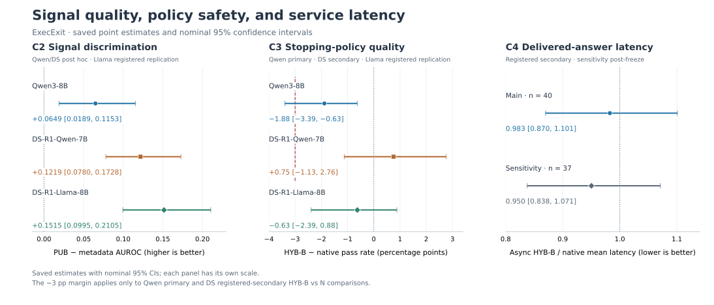
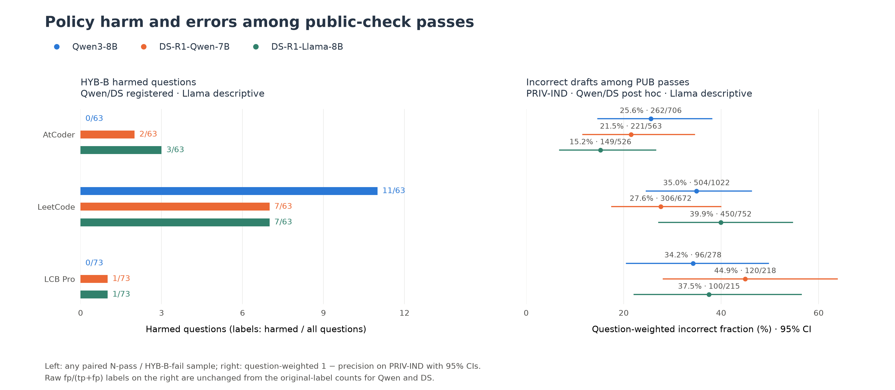
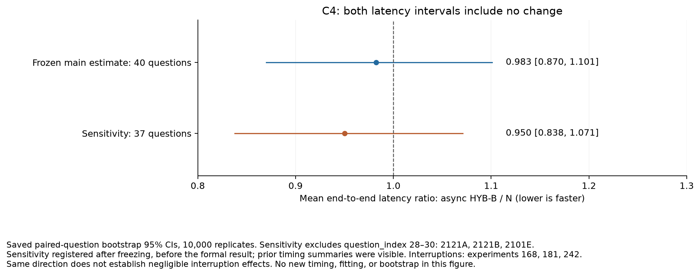
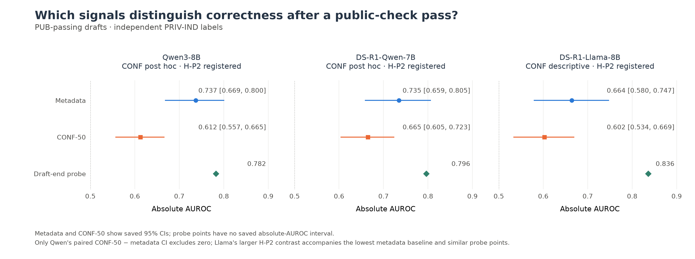

<a id="execexit-testing-public-execution-signals-for-stopping-code-reasoning"></a>

# ExecExit: Testing whether public execution signals can decide when to stop code reasoning

English · [简体中文](REPORT.zh-CN.md)

This is the full report behind the README. The README covers only the main story; here I lay out the methodological details, where every number comes from, the limitations, and how to reproduce the results.

[Results](#results) · [CPU example and reproduction](#reproduction-and-appendices)

<a id="problem"></a>

## Problem

I first noticed two things: an intermediate draft written by the model might pass the public examples yet fail the full tests, and even after the model has clearly written a working program, it keeps thinking for a long time. So I broke the problem into four steps: Does an earlier correct draft exist? Can a signal recognize it? Is it safe to stop on the signal? Once probing costs are counted, can delivery be faster?

Short answers to the four questions:

- **There is room to save.** An oracle that knows the answers could save **14.79%** (Qwen) and **13.11%** (DS) of tokens on the recorded drafts.
- **The signal recognizes correct drafts.** On all three models, PUB improves AUROC over the metadata baseline by **+0.065 to +0.152**, with every interval above zero; model confidence (CONF-50) falls **0.14–0.15** below the baseline.
- **Stopping on the signal did not pass the safety test.** On Qwen3-8B, HYB-B saved **7.91%** of tokens while the pass rate fell significantly, by **1.88** percentage points [−3.39, −0.63] (the interval excludes 0), and the lower bound crosses the pre-set −3-percentage-point non-inferiority margin.
- **No confirmed latency gain.** In the serving experiment, the async HYB-B / N latency ratio is **0.983 [0.870, 1.101]**, an interval that includes 1; asynchronous HYB-B actually generated **3.72%** more tokens in total than N.

Taken together, the most important result of this project is separating "can recognize correct drafts" from "can stop safely": the former holds on all three models, the latter does not, and the gap between them comes mainly from wrong drafts that the public tests let through.

<a id="related-work-and-scope"></a>

### Related work and scope

| Work | Related precedent | My approach |
|---|---|---|
| [interwhen](https://arxiv.org/html/2602.11202v3#A3.SS1.SSS5) | Probes intermediate Lean code and stops early once it compiles successfully. | Checks Python drafts on the public examples and delivers an accepted draft directly; failed check results are not fed back into native reasoning. |
| [RLEF](https://arxiv.org/html/2410.02089v2) | Trains iterative code repair with execution feedback; passing the public tests can end the interaction. | Evaluates stopping on a fixed model's native reasoning trajectories, with no repair training. |
| [Certaindex / Dynasor](https://arxiv.org/html/2412.20993v2) | Uses the consistency of intermediate answers in serving, and filters hesitation words. | Compares public execution signals with non-execution signals, counting the cost of visited probes and fallbacks. Hesitation-word filtering is not a new contribution of mine. |
| [STP / OTBench](https://arxiv.org/html/2610.13570v1) | Studies stopping opportunities at multiple prefixes along fixed trajectories, including code tasks. | Counts the cost of visited-but-rejected probes and of the delivered answer in policy replay, and measures serving latency separately. |
| [DEER](https://arxiv.org/abs/2504.15895) | Uses transition-word probing and confidence for early exit. | CONF-50 is a component-level comparator, not a full reproduction of DEER. |

These works are close to my question. What I add is a controlled comparison: several kinds of signals under the same cost accounting and on the same set of problems.

<a id="setup-and-evidence-status"></a>

## Setup

The primary comparison uses Qwen3-8B; DeepSeek-R1-Distill-Qwen-7B (DS or DS-Qwen below) is the pre-registered secondary model. Each model runs **199 problems, 650 samples**: AtCoder **63 × 4** and LeetCode **63 × 4** from the LiveCodeBench v6 held-out set (H-v6), plus LiveCodeBench Pro (LCB Pro below) **73 × 2**. Statistics first average within each problem and then weight all problems equally, so problems that were sampled more often don't carry more weight. [Corrected results manifest](../../runs/qwen_erratum_comparison/summary.json)

The native thinking budget is **28,000 tokens**; once it runs out, an answer is forced. Drafts are generated with greedy decoding, up to **2,048 tokens**, and all of them are saved; I then replay the various stopping rules offline under the v1 comment-abort rule. In the cost accounting I try not to give early stopping any unfair advantage: rejected drafts, delivered drafts, and native generation after a fallback are all charged, with a delivered draft charged only once; tokens generated by tools are charged the first time they are needed, and CPU cost is reported separately. Token accounting on fixed trajectories and the serving cost measured in C4 are two different things, and I report them separately.

N is native generation; BF@4096 attempts an answer at token 4,096 and falls back if the answer is invalid. FIRST, CONF-50, CONV-TEXT, and EG use different signals to decide whether to accept a draft. I kept all **43 configurations**; CONF-full is used only for signal diagnostics. [All Qwen intervals](../../runs/qwen_erratum/secondary_intervals43/FULL_TABLES.md)

Candidate positions are counted in generated native tokens, excluding the prompt, and are determined jointly by transition-word events and fixed positions.

| Signal or policy | Operational definition | Decision and information boundary |
|---|---|---|
| **CONF-50** | Computes `exp(mean(rank-one log probabilities))` over the first **at most 50 actually generated draft tokens**, i.e., the geometric mean of the top-1 probabilities. A shorter draft that ended normally uses the tokens it has; an unfinished prefix with fewer than 50 tokens has no usable score. | Only a score **strictly > 0.95** allows the complete draft to continue generating; otherwise the draft is rejected. Acceptance still requires a valid complete draft, but not PUB PASS. |
| **HYB-B** | Fixed at **k=4, m=0**: candidates are ordered by position and the **1st, 5th, 9th, …** are selected; those before **4,096** are visited, and the first valid draft that passes PUB is accepted. If none is accepted, the candidate at exactly **4,096** is checked once more on its own, outside the sparse schedule above. | The boundary draft must likewise be valid and PUB PASS; otherwise N continues, with no further probes. If generation ends before reaching the boundary, no candidate is fabricated. |
| **PUB** | Under fixed per-problem execution and comparison rules, takes the draft's **first execution result on the public examples**. PASS requires all public examples to pass; UNKNOWN cannot trigger acceptance. | The stopping policy sees neither the hidden-test results nor the labels obtained after repeated evaluation and majority adjudication. Offline correctness is a separate evaluation target: the original complete label requires a completed delivery that passes both the public examples and the hidden tests; C2's PRIV-IND label first removes tests identical to the public inputs and then uses the remaining hidden-test results. |

A valid draft must end normally, yield an unambiguous, parseable program under the extraction rules, and not have triggered the v1 comment abort. [Candidate selection](../../exec_exit/replay/policies_v1.py), [HYB-B implementation](../../exec_exit/replay/hybrid_v1.py)

Policy comparisons use **10,000 bootstrap resamples**, stratified by dataset × difficulty and paired by problem. Average pass rates can hide harm to individual problems, so I also set a stricter criterion: a problem counts as harmed if any of its paired samples passes under N and fails under HYB-B, and the one-sided **97.5%** Clopper–Pearson (CP) upper bound on the share of harmed problems must be below **3%**. Signal AUROC comparisons use cross-validation grouped by problem; their intervals, and the correlation intervals later on, come from **10,000** problem-level bootstrap resamples, with out-of-fold predictions held fixed and no refitting where cross-validation is involved. [Frozen statistics output](../../runs/qwen_erratum/statistics/summary.json)

The third model, DeepSeek-R1-Distill-Llama-8B (Llama below), was added later and uses the same **199 problems, 650 samples**. How the Qwen/DS independent labels were completed, and the labels still missing, are covered in the supplementary material; all figures and tables in this report read the saved statistics outputs directly. [Llama results and audit](../../runs/llama_results/summary.json)

<a id="evidence-status"></a>

### Evidence status

I wrote down the hypotheses and the analysis plan before seeing the held-out results, but not every analysis was done that way, so each result opens with its provenance in the form "timing · role," for example **Pre-registered · Primary test**.

Timing refers to when the analysis was written down:

- **Pre-registered:** written down before the held-out results existed. This includes the Qwen primary test and the pre-specified secondary analyses; DS-R1-Qwen was registered as the secondary model at that time.
- **Supplementary registration:** added later, but written down before the corresponding results came out. This includes the Llama C2 replication (the "registered replication" in the README), the ACD hypotheses, and the hidden-state probes.
- **Post hoc:** analyses proposed or modified only after seeing the relevant results, such as the Qwen/DS independent-label completion and the public-test strength analysis; every analysis called "exploratory" in this report belongs to this category.

Role refers to the part a result plays in the study:

- **Primary test:** the C3 primary comparison on Qwen, the only one in the entire study.
- **Secondary:** comparisons listed as secondary outcomes at registration. Those with a criterion are judged against it; those without one report only the interval.
- **Descriptive:** values reported for description only, such as counts, point estimates, or intervals the frozen code happened to output; they have no pre-specified criterion.

Post hoc analyses are not further divided by role. When models have different statuses within the same paragraph, I state each at the start of the paragraph, for example "Qwen/DS: Post hoc; Llama: Supplementary registration · Secondary." Secondary intervals are all per-comparison nominal intervals, with no multiple-comparison correction.

<a id="results"></a>

## Results

<a id="main-results-figure"></a>



*Figure 1. Left: AUROC gain of PUB over the metadata baseline; middle: pass-rate difference of HYB-B relative to N; right: mean latency ratio of asynchronous HYB-B to N. Each panel has its own scale, and error bars are nominal 95% intervals; the −3-percentage-point dashed line in the middle panel is a decision criterion only for Qwen and DS. [Plotting script](render_results.py).*

<a id="c1-earlier-passing-drafts-create-a-bounded-opportunity"></a>

### C1: Earlier passing drafts could save up to 13–15% of tokens

**Pre-registered · Secondary.** First, how much room is there? Suppose an oracle that knows the answers picks the cheapest correct answer among the recorded drafts: for Qwen it would save **14.79% [11.73, 18.19]** of tokens; **304/650** trajectories contain a passing draft earlier than the final answer, with a median positional headroom of **4,301.5 tokens**. The corresponding saving for DS is **13.11% [9.81, 16.80]**. [Qwen source](../../runs/queue_rebuild/c1c2/result/c1_aggregate_rebuilt.json), [DS source](../../runs/ds_c1c2_erratum/summary.json)

This is an idealized upper bound: the oracle knows final correctness, a draft's cost counts only the native prefix plus the tokens the draft itself generates, unselected drafts and all checks cost nothing, and N is kept when no passing option exists. Positional headroom is computed from the first passing draft and likewise excludes probing and checking costs. [Qwen C1](figures/c1_qwen.png), [DS C1](figures/c1_ds.png)

<a id="c2-confidence-execution-and-the-metadata-baseline"></a>

<a id="c2-public-execution-carries-information-beyond-the-metadata-baseline"></a>

### C2: Public execution carries information beyond the metadata baseline

**Qwen/DS: Post hoc; Llama: Supplementary registration · Secondary (R1).** C2 asks how much more information public execution provides beyond a metadata baseline that knows only difficulty, tokens used so far, and probe index. The label is PRIV-IND (only hidden tests that don't duplicate the public inputs), and the baseline is refit on this label. Qwen/DS count as post hoc because the decision to complete the labels was made only after seeing the first results; Llama's R1 was registered before its results came out. [Completion definition and status](../../runs/c2_label_completion/final_counts.json)

| Model | PUB AUROC, PRIV-IND | Refit baseline AUROC | PUB − baseline [95% CI] | Metadata + PUB AUROC | Known / eligible drafts; problems |
|---|---:|---:|---:|---:|---:|
| Qwen3-8B | 0.8694 | 0.8044 | +0.0649 [0.0189, 0.1153] | 0.9313; Δ +0.1268 [0.0960, 0.1620] | 4,203/4,204; 197 |
| DS-R1-Qwen-7B | 0.9376 | 0.8157 | +0.1219 [0.0780, 0.1728] | 0.9590; Δ +0.1433 [0.1039, 0.1887] | 7,023/7,128; 199 |
| DS-R1-Llama-8B | 0.9235 | 0.7720 | +0.1515 [0.0995, 0.2105] | 0.9349; Δ +0.1628 [0.1188, 0.2127] | 6,094/6,099; 199 |

*Sources: [Qwen](../../runs/c2_label_completion/raw/qwen_completed/main/summary.json), [DS-Qwen](../../runs/c2_label_completion/raw/ds_completed/main/summary.json), [Llama](../../runs/llama_execution_repair1/blind/analysis/results/private_c2.json). The three models still have **1, 105, and 5** drafts, respectively, with UNKNOWN labels; I excluded them from the comparison rather than treating them as FAIL.*

The "Metadata + PUB AUROC" column answers a different question: once the metadata is known, how much does adding the execution signal improve things? Its Δ is the joint model's gain over the refit baseline. The gains are **+0.127, +0.143, and +0.163** on the three models, with every interval above zero: execution results carry discriminative information beyond the metadata. This column is labeled Qwen/DS: Post hoc; Llama: Supplementary registration · Descriptive (an incidental output of the frozen code).

CONF-50 keeps the original complete label (the delivered program must pass both the public examples and the hidden tests), which is a different target from PRIV-IND. For the circularity problem with the PUB comparison under the original label, see the [supplementary table](#original-complete-label-c2-results).

| Model | CONF-50 AUROC, original complete label | Metadata baseline AUROC | CONF-50 − baseline [95% CI] |
|---|---:|---:|---:|
| Qwen3-8B | 0.680 | 0.817 | −0.138 [−0.190, −0.081] |
| DS-R1-Qwen-7B | 0.676 | 0.824 | −0.148 [−0.200, −0.095] |
| DS-R1-Llama-8B | 0.6551 | 0.7960 | −0.1409 [−0.2099, −0.0727] |

*Qwen/DS: Pre-registered · Secondary; Llama: Supplementary registration · Secondary (R2 replication). [Qwen data rows](../../runs/qwen_c1c2_erratum/raw/signal_metrics.jsonl), [DS-Qwen data rows](../../runs/ds_c1c2_erratum/raw/signal_metrics.jsonl), [Llama data rows](../../runs/llama_execution_repair1/blind/analysis/results/raw/signal_metrics.jsonl).*

Both of Llama's registered replications pass their criteria (R1's lower bound > 0, R2's upper bound < 0), matching the direction of the first two models. The overall PUB advantage for Qwen/DS still holds under the timeout-sensitivity analysis, but it is not uniform: Qwen's AtCoder and LeetCode intervals and DS's LeetCode sensitivity interval all include zero. Being able to recognize correct drafts does not mean it is safe to stop on them; that is what C3 tests.

<a id="policy-outcomes"></a>

<a id="c3-the-stopping-policy-did-not-establish-the-primary-claim"></a>

### C3: The stopping rule saved tokens but failed the non-inferiority test

**Pre-registered · Primary test (Qwen).** On Qwen3-8B, HYB-B saved **7.91%** of tokens while the pass rate fell by **1.88** percentage points (95% CI −3.39 to −0.63). The interval excludes 0, so the drop is real; the lower bound crosses the pre-set −3-percentage-point margin, so nominal non-inferiority was not established; the stricter harm criterion was not met either. The table below also lists the pre-correction results; the conclusions follow the corrected version (see [below](#lcb-pro-public-input-defect-and-correction) for why the correction was made). [Original vs. corrected comparison table](../../runs/qwen_erratum_comparison/raw/comparisons.json)

| Version / comparison | Pass-rate difference, pp (95% CI) | Token saving, % (95% CI) | Registered verdict |
|---|---:|---:|---|
| Original: HYB-B − N | −1.13 [−2.76, 0.38] | 7.53 [4.61, 10.77] | Only nominal non-inferiority established; superseded by the correction |
| Corrected: HYB-B − N | −1.88 [−3.39, −0.63] | 7.91 [4.97, 11.15] | Neither nominal nor strict non-inferiority established |
| Original: HYB-B − BF@4096 | 1.63 [−0.50, 3.77] | −10.22 [−14.88, −6.01] | Sequential test not established |
| Corrected: HYB-B − BF@4096 | 1.63 [−0.50, 3.77] | −9.77 [−14.36, −5.56] | Sequential test not established |

<details>
<summary>Qwen3 primary results: original frozen version vs. corrected version</summary>

| Version | N problem-averaged pass rate | BF@4096 problem-averaged pass rate | HYB-B problem-averaged pass rate | HYB-B mean tokens |
|---|---:|---:|---:|---:|
| Original frozen | 36.68% | 33.92% | 35.55% | 16,007.06 |
| Corrected | 40.95% | 37.44% | 39.07% | 15,941.62 |

| Collection | HYB-B − N, pp (original frozen → corrected) | Token saving % (original frozen → corrected) | Problems harmed at least once / problems | One-sided 97.5% CP upper bound |
|---|---:|---:|---:|---:|
| Overall | −1.13 → −1.88 | 7.53 → 7.91 | 11 / 199 | 9.68% |
| AtCoder | 0.40 (unchanged) | 9.73 (unchanged) | 0 / 63 | 5.69% |
| LeetCode | −6.35 (unchanged) | 21.35 (unchanged) | 11 / 63 | 29.10% |
| LCB Pro | 2.05 → 0.00 | −1.66 → −0.81 | 0 / 73 | 4.93% |

By collection, only LCB Pro changed; the harm counts and upper bounds for each collection are the same in both versions. Among only the problems N passed at least once, **11/91** are harmed in the original frozen version (upper bound 20.60%) and **11/102** in the corrected version (upper bound 18.48%).

[Full comparison fields and source hashes](../../runs/qwen_erratum_comparison/summary.json) · [Per-collection comparisons, the subset N passed at least once, rescue/harm details](../../runs/qwen_erratum_comparison/raw/comparisons.json) · [Secondary intervals for the 43 configurations](../../runs/qwen_erratum/secondary_intervals43/FULL_TABLES.md)

</details>

Under the strict criterion, **11/199** problems are harmed after the correction, with a CP upper bound of **9.68%**, far above 3%. A problem N never solves cannot be harmed, so I also pre-registered a secondary outcome: among only the problems N solved at least once, harm is **11/102**, with an upper bound of **18.48%**. [Source](../../runs/qwen_erratum_comparison/raw/comparisons.json)

**Pre-registered · Secondary (DS).** HYB-B − N is **+0.75 percentage points [−1.13, 2.76]**, with a token saving of **13.39% [9.38, 17.51]**. Nominal non-inferiority passes, but the strict criterion still fails (**10/199** harmed; upper bound **9.05%**). [Source](../../runs/queue_rebuild/ds_checkpoint_recovery1/result/statistics/summary.json)

**Supplementary registration · Secondary (Llama, no pre-set criterion).** HYB-B − N is **−0.63 percentage points [−2.39, 0.88]**, with a token saving of **10.72% [6.68, 15.09]**; BF@4096 − N is **−4.15 percentage points [−6.41, −2.14]**, with a token saving of **38.18% [34.12, 42.30]**. [43-configuration output](../../runs/llama_execution_repair1/blind/analysis/results/intervals43.json)

**Supplementary registration · Descriptive (Llama).** Under the C3 harm definition, Llama has **11/199** harmed problems. [Saved statistics](../../runs/llama_execution_repair1/blind/analysis/results/statistics.json)

Nominal non-inferiority requires the lower bound of the 95% interval for HYB-B − N to be **strictly above −3 percentage points**. This criterion applies only to the Qwen primary comparison and the DS secondary comparison. [Criterion implementation: summarize](../../exec_exit/analysis/stats.py)


*Pass-rate difference and token saving for all 43 configurations on the three models; error bars are per-comparison nominal 95% intervals, and ORACLE is an offline reference. The −3-percentage-point dashed line applies only to the HYB-B − N comparison for Qwen and DS. [Sources and filters](../../runs/report_figures/sources.json)*

<a id="policy-harm-and-public-false-acceptance"></a>

#### Policy harm and false acceptance on public examples

Why does the policy harm problems? The table below breaks the harmed problems down by collection and shows how many of the drafts accepted by the public-example check are still wrong.

The left columns use the C3 harm definition and are labeled Qwen/DS: Pre-registered · Secondary; Llama: Supplementary registration · Descriptive. [Qwen harm](../../runs/qwen_erratum_comparison/raw/comparisons.json), [DS harm](../../runs/queue_rebuild/ds_checkpoint_recovery1/result/statistics/summary.json), [Llama harm](../../runs/llama_execution_repair1/blind/analysis/results/statistics.json)

The right columns give the share of wrong drafts among accepted drafts under the **PRIV-IND** label, i.e., 1 − weighted precision, with every problem weighted equally. The "raw counts" after the semicolon are unweighted `fp/(tp+fp)` draft counts; for Qwen/DS, the counts in these six cells are the same as under the original complete label. The right columns are labeled Qwen/DS: Post hoc; Llama: Supplementary registration · Descriptive. [Qwen PRIV-IND](../../runs/c2_label_completion/raw/qwen_completed/main/summary.json), [DS PRIV-IND](../../runs/c2_label_completion/raw/ds_completed/main/summary.json), [Llama PRIV-IND](../../runs/llama_execution_repair1/blind/analysis/results/private_c2.json)

| Dataset | Qwen harmed / problems | DS harmed / problems | Llama harmed / problems | Qwen wrong among accepted [95% interval]; raw counts | DS wrong among accepted [95% interval]; raw counts | Llama wrong among accepted [95% interval]; raw counts |
|---|---:|---:|---:|---:|---:|---:|
| AtCoder | 0/63 | 2/63 | 3/63 | 25.6% [14.7, 38.1]; 262/706 | 21.5% [11.6, 34.5]; 221/563 | 15.2% [6.9, 26.6]; 149/526 |
| LeetCode | 11/63 | 7/63 | 7/63 | 35.0% [24.6, 46.2]; 504/1,022 | 27.6% [17.6, 40.0]; 306/672 | 39.9% [27.2, 54.6]; 450/752 |
| LCB Pro | 0/73 | 1/73 | 1/73 | 34.2% [20.6, 49.7]; 96/278 | 44.9% [28.2, 63.8]; 120/218 | 37.5% [22.1, 56.4]; 100/215 |



Harmed problems are concentrated in LeetCode (Qwen 11/11, DS 7/10, Llama 7/11). The right columns count every draft that passes the public-example check, and those drafts are not necessarily selected by the policy, so the right columns are not the actual delivered error rate. For the per-problem analysis, see the [mechanism section below](#mechanism-public-test-strength-exploratory).

**Qwen/DS: Pre-registered · Secondary; Llama: Supplementary registration · Secondary.** The cost of stopping on confidence is more pronounced. Under the same frozen CONF-50 `k1,m0` configuration, the pass-rate difference relative to N is: Qwen **−12.44 percentage points [−15.95, −9.17]** (saving **45.71%**), DS **−1.38 percentage points [−3.27, 0.38]** (saving **51.59%**), Llama **−6.16 percentage points [−8.54, −3.89]** (saving **44.31%**). How large the harm is varies by model. [Qwen intervals](../../runs/qwen_erratum/secondary_intervals43/raw/comparisons.jsonl), [DS intervals](../../runs/queue_rebuild/ds_checkpoint_recovery1/result/secondary_intervals43/raw/comparisons.jsonl), [Llama intervals](../../runs/llama_execution_repair1/blind/analysis/results/intervals43.json)

**Pre-registered · Secondary (ablation).** I also tried adding checks beyond the public examples: self-generated stress tests (STRESS) and behavioral agreement with the previous draft (AGREE). On the AtCoder `k4,m0` subset, HYB-B, EG-2, and EG-S all pass **121/252**, and EG-A and EG-SA pass **120/252**; the mean billed tokens are, in that order, **15,058.08, 17,198.52, 17,869.50, 17,832.68, and 18,618.42**. The extra checks did no better than "wait for the second draft that passes the public examples," and cost more. The rest of the registered grid is kept in the [ablation figure](figures/atcoder_ablation.png) and the [source table](../../runs/qwen_atcoder_ablation/heldout/comparison_tables.json).

<a id="service-costs"></a>

<a id="c4-token-savings-did-not-establish-a-service-latency-improvement"></a>

### C4: Token savings did not establish a serving-latency improvement

**Pre-registered · Secondary.** Can tokens saved offline turn into real time saved? I ran an actual serving experiment with Qwen3-8B on **40 problems** (18 AtCoder, 22 LCB Pro, all with stdin/stdout interfaces), running each problem once per arm and load. In the serial primary comparison, the mean end-to-end latency ratio of asynchronous HYB-B / N is **0.983 [0.870, 1.101]**, and for the synchronous version it is **0.992 [0.891, 1.092]**; both intervals include 1. The intervals are 95% intervals from problem-paired bootstrap resampling. On the same problems, asynchronous HYB-B actually generated **3.72%** more tokens in total than N (see the cost paragraph below). [Saved latency output](../../runs/c4_recovery1/latency_analysis/summary.json)

**Post hoc (sensitivity analysis).** The experiment was interrupted partway through. After the original freeze but before looking at the results, I declared that indices **28–30** near the interruption (`2121A`, `2121B`, `2101E`) would be excluded, leaving **37 problems**, for which asynchronous / N is **0.950 [0.838, 1.071]**. This was not fully blind: I had seen timings earlier while estimating how long runs would take. Both intervals include "no change." [Declaration and output](../../runs/c4_recovery1/sensitivity/summary.json)



**Pre-registered · Descriptive.** H is a control arm that pauses and then resumes directly, without generating a draft. Correctness in the table below comes from independent full testing of the programs actually delivered.

| Serial arm | Mean end-to-end latency, s | Delivered programs passing / planned |
|---|---:|---:|
| N | 227.219 | 16/40 (40.0%) |
| BF@4096 | 212.671 | 15/40 (37.5%) |
| CONF-50 | 151.651 | 12/40 (30.0%) |
| HYB-B-SYNC | 225.497 | 15/40 (37.5%) |
| HYB-B-ASYNC | 223.258 | 14/40 (35.0%) |
| H | 223.200 | 15/40 (37.5%) |

*Sources: [serial latency](../../runs/c4_recovery1/latency_analysis/summary.json), [scoring of the actually delivered programs](../../runs/c4_recovery1/delivered_evaluation/summary.json). Pass counts are the sum of the AtCoder and LCB Pro parts for each arm and load.*

**Pre-registered · Descriptive (load experiment).** The same 40 problems were also run under two Poisson-arrival loads. The frozen arrival rate is `lambda = c / S`, where `S` is N's serial mean latency; **c=4 and c=8 are load parameters, not fixed actual concurrency levels**. Under each load, N and asynchronous HYB-B were each run once, with the same problem order and arrival-time sequence. At c=4, N ran first and then asynchronous; at c=8, asynchronous ran first and then N.

| Poisson load | Mean latency ratio | p50 latency ratio | p90 latency ratio | N passing / planned | Async HYB-B passing / planned |
|---|---:|---:|---:|---:|---:|
| c=4 | 1.158 | 1.424 | 1.116 | 15/40 (37.5%) | 16/40 (40.0%) |
| c=8 | 0.886 | 0.959 | 0.998 | 16/40 (40.0%) | 16/40 (40.0%) |

*Each ratio is asynchronous HYB-B / N for the corresponding latency statistic; below 1 means faster. These are saved point estimates with no confidence intervals. Sources: [Poisson-load latency](../../runs/c4_recovery1/latency_analysis/summary.json), [scoring of delivered programs](../../runs/c4_recovery1/delivered_evaluation/summary.json).*

Mean latency goes up at c=4 and down at c=8, but p90 barely changes. Each load was run only once, so there is no sign of a repeatable speedup, nor of any difference in delivery quality.

**Pre-registered · Descriptive (cost and rejection overhead).** In actual serving, serial asynchronous HYB-B generated **812,296 tokens** in total, **3.72%** more than N's **783,162** (including visible abort tails). For problems that were probed at least once but had every draft rejected, asynchronous latency was on average **4.77%** higher (**34 problems**) and synchronous **4.25%** higher (**35 problems**), both within the registered 5% descriptive check. [Cost output](../../runs/c4_recovery1/latency_analysis/summary.json)

All **400 planned logical requests** (240 serial, 160 Poisson) had their latency and PASS/FAIL labels recovered. Three interruptions left tails that were never written to disk and cancellation costs that could not be observed, and the effect of the restarts was not separately identified. [Recovery and timing sources](../../runs/c4_recovery1/sensitivity/summary.json)

<a id="hidden-state-probe-addendum"></a>

<a id="hidden-state-probes"></a>

<a id="hidden-state-probes-no-established-advantage-over-pub-conditional-gain-only-for-llama"></a>

## Hidden-state probes: no established advantage over PUB; a conditional gain only for Llama

**Supplementary registration · Secondary.** Beyond running the draft, does the model already "know" internally whether the draft is right? I registered this follow-up study after the C2 results were known, but before development-set selection and held-out fitting (feature extraction, which does not read labels, started earlier). The method trains a single-layer logistic regression on the hidden state at the end of the complete draft, using the completed PRIV-IND label; the layer and the regularization parameter were chosen on the development set Dev121 and then locked. H-P1 asks whether the probe can beat PUB; H-P2 asks whether, among drafts that already pass PUB, the probe can beat the refit metadata baseline. The problem set is still the original one, not a new blind test. [Completion record](../../runs/probe_execution/FULL_TABLES.md)

| Model | H-P1: probe − PUB, AUROC [95% CI] | H-P2: probe − baseline within the PUB-pass subset, AUROC [95% CI] | Known drafts / problems; PUB-pass drafts / problems |
|---|---:|---:|---:|
| Qwen3-8B | +0.0148 [−0.0202, +0.0487] | +0.0456 [−0.0111, +0.1024] | 4,203/197; 2,006/148 |
| DS-R1-Qwen-7B | −0.0074 [−0.0346, +0.0165] | +0.0615 [−0.0115, +0.1341] | 7,023/199; 1,453/133 |
| DS-R1-Llama-8B | −0.0187 [−0.0538, +0.0133] | +0.1721 [+0.0930, +0.2508] | 6,094/199; 1,493/133 |

*The values and each model's verdict are transcribed in the [full tables](../../runs/probe_execution/FULL_TABLES.md). [Qwen output](../../runs/probe_execution/fit/qwen/heldout/summary.json), [DS-Qwen output](../../runs/probe_execution/fit/ds/heldout/summary.json), [Llama output](../../runs/probe_execution/fit/llama/heldout/summary.json).*



*The PUB-pass subset uses the PRIV-IND label. Metadata and CONF-50 are drawn with their saved 95% intervals; the probe's absolute AUROC has no saved interval, so only points are drawn.*

**Qwen/DS: Post hoc; Llama: Supplementary registration · Secondary.** Among drafts that already pass the public examples, the AUROC difference CONF-50 − refit metadata baseline is **−0.124 [−0.206, −0.041]**, **−0.070 [−0.151, 0.014]**, and **−0.062 [−0.158, 0.035]** for Qwen, DS-Qwen, and Llama respectively; only Qwen's interval excludes zero. [Qwen](../../runs/c2_label_completion/raw/qwen_completed/main/summary.json), [DS-Qwen](../../runs/c2_label_completion/raw/ds_completed/main/summary.json), [Llama](../../runs/llama_execution_repair1/blind/analysis/results/private_c2.json)

The three H-P2 differences are **+0.046 / +0.062 / +0.172**, and only Llama's interval excludes zero. Broken down, the probe's absolute AUROC is **0.782 / 0.796 / 0.836** and the metadata baseline's is **0.737 / 0.735 / 0.664**: Llama's larger difference comes partly from its lower baseline and partly from a slightly higher probe score. [Qwen probe](../../runs/probe_execution/fit/qwen/heldout/summary.json), [DS-Qwen probe](../../runs/probe_execution/fit/ds/heldout/summary.json), [Llama probe](../../runs/probe_execution/fit/llama/heldout/summary.json)

**Conclusion: H-P1 does not hold on any of the three models; H-P2 holds only on Llama.** The probe also requires generating the complete draft first and then an extra forward pass; I have not yet tested whether it can become a better stopping rule or save time. [Secondary results, method limitations, audit, and resources](#probe-methods-and-resources)

<a id="mechanism-public-test-strength-exploratory"></a>

<a id="exploratory-public-test-strength-miss-rates-are-associated-with-policy-harm"></a>

## Public-test strength: miss rates are associated with policy harm (exploratory)

**Post hoc.** C3's harmed problems are concentrated in LeetCode, and I wanted to know whether the public examples there are too weak. The plan was written down after C2 and the harm summary were known, but before any per-problem computation. I define each problem's **miss rate** as the fraction of incorrect drafts that pass PUB (the denominator differs from that of the earlier "share of wrong drafts among accepted drafts"). [Saved estimates](../../runs/public_test_strength/summary.json)

**M1: Is the miss rate a property of the problem?** If so, different models' miss rates on the same problem should be similar. They are indeed positively correlated (each model pair includes only problems where both models have at least three incorrect drafts). But this could be because the problem's tests are weak or because the models make the same mistakes; the two can't be separated here.

| Model pair | Eligible problems | Spearman ρ [95% CI] |
|---|---:|---:|
| Qwen3 / DS-R1-Qwen | 149 | 0.644 [0.520, 0.750] |
| Qwen3 / DS-R1-Llama | 149 | 0.581 [0.448, 0.697] |
| DS-R1-Qwen / DS-R1-Llama | 170 | 0.695 [0.585, 0.789] |

*Source: [saved M1 correlation coefficients](../../runs/public_test_strength/summary.json).*

**M2: Are there too few public examples?** It seems not. For problems with at least three incorrect drafts in total across the models, the correlation between the number of examples and the pooled miss rate is **+0.14 [0.0009, 0.29]** overall (**181** problems), **−0.14 [−0.39, 0.12]** for AtCoder (**56**), **−0.08 [−0.33, 0.19]** for LeetCode (**53**), and **−0.20 [−0.30, −0.11]** for LCB Pro (**72**). Positive overall but negative within each collection: the relationship depends on how the data are aggregated, so we can't say the number of examples itself is having an effect. The number of examples barely varies on LCB Pro, so the correlation is undefined in **443/10,000** resamples; the interval is computed from the remaining resamples. [M1/M2 sources](../../runs/public_test_strength/summary.json)

**M3: Can other models predict harm?** For each target model, I rank problems by the pooled miss rate of the other two models and see whether it distinguishes whether HYB-B lowered that model's **per-problem average pass proportion**. Included problems must have N pass at least once on the target model, and the other two models must have at least one incorrect draft.

| Target model | Eligible problems | Problems harmed under this definition | AUROC of the other models' miss rate [95% CI] |
|---|---:|---:|---:|
| Qwen3 | 91 | 10 | 0.91 [0.82, 0.98] |
| DS-R1-Qwen | 53 | 9 | 0.76 [0.57, 0.93] |
| DS-R1-Llama | 53 | 8 | 0.92 [0.82, 0.99] |

Qwen's 10/91 here is not the same thing as the primary test's 11/199: the primary test asks whether any paired sample passed under N and failed under HYB-B, while this requires the per-problem average pass proportion to drop, and the problem must have a score computable from the other models. Llama's interval drops **3** resamples whose result is undefined. [M3 source](../../runs/public_test_strength/summary.json), [primary harm source](../../runs/qwen_erratum_comparison/raw/comparisons.json)

Harmed problems are mostly in LeetCode, so a natural objection is: could the miss rate just be a proxy for collection identity? I added this check only **after seeing M3**. Scoring by collection identity alone gives AUROCs of **0.84/0.64/0.76** for Qwen/DS-Qwen/Llama. Within LeetCode alone, the AUROC of the other models' miss rate is still: Qwen **0.91 [0.79, 0.98]** (**10/36** harmed), DS-Qwen **0.75 [0.46, 0.98]** (**6/22**), Llama **0.89 [0.69, 1.00]** (**6/18**). DS's interval includes 0.5, and the samples are small (the three models have **0/6/10** resamples with undefined results, respectively). [Within-LeetCode check](../../runs/public_test_strength/posthoc_within_leetcode.json)

**M4: Descriptive summary.** The median number of public examples for AtCoder/LeetCode/LCB Pro is **3/2/1**. The problem-weighted mean miss rate is **21%/37%/13%** for Qwen, **10%/19%/7%** for DS-Qwen, and **6%/21%/8%** for Llama. One surprise: Qwen has the highest miss rate on all three collections, and it is also the model that solves the most problems; the reason can't be separated out here. [Descriptive counts and eligible samples](../../runs/public_test_strength/summary.json)

**Summary.** On eligible existing problems, the other models' miss rates pick out the problems where HYB-B lowered the target model's per-problem average pass rate (M3, AUROC **0.76–0.92**), offline evidence for cross-model risk stratification. These are correlational results; the causal source of the miss rate and its generalization to new problems still need intervention experiments and validation on new problems.

<a id="lcb-pro-public-input-defect-and-correction"></a>

## LCB Pro public-input defect and correction

This is the problem that changed my primary conclusion. Blank lines had crept into the public inputs extracted for LCB Pro, which could break programs that were otherwise correct and read input line by line; in other words, correct drafts were wrongly judged as failing the public-example check. I checked all **73 problems and 78 examples** against the official Codeforces HTML. All **78 corrected inputs** match the structured HTML parse byte for byte; **70 outputs** match byte for byte, and the remaining **8** differ only in trailing whitespace, which I left as is. [Verification receipt](../../runs/lcb_public_erratum/official_html_v3/verification_receipt_v3.json), [audited correction](../../runs/qwen_erratum_comparison/raw/comparisons.json)

The correction was applied uniformly to every policy's public-example checks, final labels, replay, and statistics; I did not regenerate any model output, and hidden-test results were reused only when the cache identity matched exactly. After the correction, nominal non-inferiority for the primary comparison went from established to not established.

<a id="limitations-and-interpretation"></a>

## Limitations and interpretation

- **Models:** three 7–8B models from two base-model families. They differ in scale and training history, so I can't separate the effects of the base model and of training, and I don't know whether the conclusions generalize to larger models.
- **Contamination:** the H-v6 problems predate the Qwen3 release; the LCB Pro problems are newer, but contamination can't be ruled out for them either. [Audit results](../../runs/llama_results/summary.json)
- **Fixed problems and trajectories:** all conclusions rest on this set of problems and these sampled trajectories. LCB Pro is sampled only twice per problem, which makes harm harder to observe; heterogeneity across strata also does not fully satisfy the independent, identical-probability assumption that the CP formula requires. [Statistical limitations](../../runs/qwen_erratum_comparison/raw/comparisons.json)
- **Scope of the signal metrics:** they cover only eligible drafts and do not represent the full generation process.
- **Serving experiment:** interruptions and unobservable cancellation overhead limit the latency conclusions. [C4 limitations](../../runs/c4_recovery1/sensitivity/summary.json)

<a id="supplementary-analyses-and-historical-diagnostics"></a>

## Supplementary analyses and historical diagnostics

<details>
<summary>Original complete-label C2 table and the current three-model signal figure</summary>

<a id="original-complete-label-c2-results"></a>

The original-label table covers **197 problems, 4,204 drafts** for Qwen and **199 problems, 7,128 drafts** for DS. The baseline, problem-level cross-validation, and interval method are the same as in C2; for other specifications, see the [appendix](../../runs/report_figures/C2_APPENDIX.md). [Qwen source](../../runs/qwen_c1c2_erratum/raw/signal_metrics.jsonl), [DS source](../../runs/ds_c1c2_erratum/raw/signal_metrics.jsonl)

| Original complete label (includes PUB), all deliverable drafts | Qwen AUROC | Difference from baseline (95% CI) | DS AUROC | Difference from baseline (95% CI) |
|---|---:|---:|---:|---:|
| Metadata baseline | 0.817 | — | 0.824 | — |
| CONF-50 | 0.680 | −0.138 [−0.190, −0.081] | 0.676 | −0.148 [−0.200, −0.095] |
| CONF-full | 0.772 | −0.045 [−0.086, −0.002] | 0.814 | −0.010 [−0.054, 0.037] |
| PUB | 0.879 | +0.062 [0.016, 0.112] | 0.947 | +0.123 [0.078, 0.175] |

*The two CONF rows: Pre-registered · Secondary; the PUB row: Post hoc (the original protocol registered PUB precision/recall). For the exact filters, see the [plot data](../../runs/report_figures/raw/plot_data.json).*

**Pre-registered · Secondary.** PUB's weighted precision is **0.685 [0.611, 0.753]** for Qwen and **0.717 [0.636, 0.788]** for DS; the matched baseline precisions are **0.701** and **0.675**, and the intervals for both paired precision differences cross zero. Under the original complete label, PUB's recall is **1.000** on both models, but that follows from the definition (see the next paragraph). So the precision advantage I registered was not established. [Signal table](../../runs/report_figures/C2_APPENDIX.md)

**Label circularity.** The complete label requires passing both the public examples and the hidden tests, so PUB is part of the target, and perfect recall cannot count as independent predictive evidence. Majority adjudication of timeouts can also make the first PUB signal disagree with the final label. [Adjudication implementation](../../exec_exit/execute/evaluate_dev.py), [C2 input construction](../../runs/ds_c1c2_erratum/source/heldout_c1c2.py)


*95% intervals over all deliverable drafts for the three models. Left: PUB − refit baseline under PRIV-IND; right: CONF-50 − baseline under the original complete label. [Values and sources](../../runs/readme_figure/values.json).*

</details>

<details>
<summary>Completing PRIV-IND: label completion, timeout sensitivity, and remaining UNKNOWNs</summary>

<a id="completed-priv-ind-post-hoc-completion-and-timeout-sensitivity"></a>

### Completed PRIV-IND: post hoc completion and timeout sensitivity

**Post hoc.** I revised the completion rules after looking at the selective-missingness diagnostics, and wrote them down before the new round of execution. Completion preserves the LeetCode call order and the same `Solution` instance; calls identical to the public inputs don't count toward the label, and execution continues past them if they fail, while a failing hidden-test call that does count toward the label still stops execution. CPU-timeout retests and majority adjudication use only the hidden-test results that count toward the label. I filled in only labels that were previously UNKNOWN; known labels, PUB, the problem fold splits, and the estimation settings are all unchanged. [Execution and merge records](../../runs/c2_label_completion/final_counts.json)

In total I completed **2,867** unique problem/program jobs, corresponding to **2,980** draft references that were previously UNKNOWN. The table below counts drafts: the same program may be referenced more than once, and a completed job may still leave an UNKNOWN. [Final counts](../../runs/c2_label_completion/final_counts.json)

| Model | Previously UNKNOWN | New PASS | New FAIL | Still UNKNOWN, primary analysis | UNKNOWN, sensitivity analysis |
|---|---:|---:|---:|---:|---:|
| Qwen | 843 | 6 | 836 | 1 | 38 |
| DS | 2,137 | 13 | 2,019 | 105 | 215 |

The remaining UNKNOWNs are Qwen **1/4,204** and DS **105/7,128**, all in LeetCode; none of the planned jobs is missing. Among the **104** unique programs still UNKNOWN, **15** have result counts that don't match their timing counts, and **10** of those carry a `MemoryError` on the first retained test case; without the raw arrays and call stacks, I can't tell whether the problem lies in execution, timing, or error formatting. The timeout-sensitivity analysis turns newly completed drafts that failed only because of timeouts (Qwen **37**, DS **110**) back into UNKNOWN; the rule covers both CPU and wall-clock timeouts, and in this run all of them were actually CPU timeouts. Previously known labels are unchanged. [Qwen merge](../../runs/c2_label_completion/raw/qwen_completed/summary.json), [DS merge](../../runs/c2_label_completion/raw/ds_completed/summary.json), [Failure types and remaining UNKNOWNs](../../runs/c2_label_completion/final_counts.json), [Consistency check](../../exec_exit/execute/private_sequence.py)

Of Llama R1's **6,099** drafts, **6,094** have known labels, covering **199 problems**. The remaining **5** are all LeetCode drafts that failed PUB and whose execution records failed to align; **3** of them carry `MemoryError` metadata. I kept them as UNKNOWN. The complete labels used by R2 and by the policy/ACD analyses have no UNKNOWNs. [Unknown details](../../runs/llama_results/raw/unknown_details.json)

The table below gives the AUROC difference PUB − refit baseline with **95%** intervals. The primary analysis covers **197** problems for Qwen and **199** for DS; UNKNOWNs stay in the records but do not enter the comparison. [Qwen primary analysis](../../runs/c2_label_completion/raw/qwen_completed/main/summary.json), [Qwen sensitivity analysis](../../runs/c2_label_completion/raw/qwen_completed/timeout_sensitivity/summary.json), [DS primary analysis](../../runs/c2_label_completion/raw/ds_completed/main/summary.json), [DS sensitivity analysis](../../runs/c2_label_completion/raw/ds_completed/timeout_sensitivity/summary.json)

| Model | Scope | Primary ΔAUROC [95% CI] | Timeout-sensitivity ΔAUROC [95% CI] | Known drafts, primary / sensitivity |
|---|---|---:|---:|---:|
| Qwen | Overall | +0.0649 [0.0189, 0.1153] | +0.0641 [0.0179, 0.1145] | 4,203 / 4,166 |
| Qwen | AtCoder | −0.0027 [−0.0768, 0.0795] | −0.0027 [−0.0768, 0.0795] | 1,469 / 1,469 |
| Qwen | LeetCode | +0.0203 [−0.0730, 0.1245] | +0.0175 [−0.0767, 0.1240] | 1,842 / 1,805 |
| Qwen | LCB Pro | +0.1397 [0.0710, 0.2212] | +0.1397 [0.0710, 0.2212] | 892 / 892 |
| DS | Overall | +0.1219 [0.0780, 0.1728] | +0.1205 [0.0762, 0.1719] | 7,023 / 6,913 |
| DS | AtCoder | +0.0596 [0.0002, 0.1310] | +0.0596 [0.0002, 0.1310] | 2,559 / 2,559 |
| DS | LeetCode | +0.0672 [0.0059, 0.1487] | +0.0602 [−0.0032, 0.1433] | 2,630 / 2,520 |
| DS | LCB Pro | +0.1838 [0.1231, 0.2535] | +0.1838 [0.1231, 0.2535] | 1,834 / 1,834 |

Neither completion changed the data rows or estimates for the PUB-pass subset, so the [subset table below](#historical-priv-ind) keeps the original values; the original CONF results and R2 are also unchanged. [Qwen merge check](../../runs/c2_label_completion/raw/qwen_completed/summary.json), [DS merge check](../../runs/c2_label_completion/raw/ds_completed/summary.json)

**Measurement limitations.** The new completion ran on a Gold 6430, while the old labels came from a Platinum 8470Q; the timeout-sensitivity analysis can neither isolate the effect of the CPU difference nor eliminate selection bias. LeetCode's public calls may still affect later tests through instance or global state, and removing tests with identical inputs does not eliminate semantic overlap, limited coverage, or data contamination. [Completion sources and missingness](../../runs/c2_label_completion/final_counts.json)

</details>

<a id="historical-priv-ind"></a>
<details>
<summary>Independent-label definition, input audit, and the public-pass subset</summary>

<a id="priv-ind-post-hoc-calculation-under-a-definition-written-before-calculation"></a>

**Historical background.** In the first computation, Qwen's overall interval included zero, and the labels had selective missingness. I then revised §3 of the supplementary registration, filled in the labels that had been cut off by stop-on-first-failure, and recomputed R1. [Current status](../../runs/c2_label_completion/final_counts.json)

PRIV-IND first converts CRLF to LF and strips exactly one trailing LF, then removes hidden test cases identical to the public inputs. Test cases keep their original order, timeout adjudication uses only the retained results, and unobserved test cases are recorded as UNKNOWN. C2's functions, fold splits, resampling seeds, and weights are all unchanged; the [original text of supplementary registration §3](../../runs/c2_label_independence/label_definition.md) was written before the new labels and estimates.

The input audit removed **63/2,288** AtCoder, **10/2,367** LeetCode, and **5/4,243** LCB Pro test cases from the hidden tests, and no problem lost all of its hidden tests as a result. Additionally stripping trailing spaces/tabs and all trailing blank lines **did not add a single match**; this descriptive rule did not change PRIV-IND. [Input audit](../../runs/c2_label_independence/raw/overlap_summary.json)

The initial label missingness was not random: **843/4,204** Qwen drafts and **2,137/7,128** DS drafts had UNKNOWN PRIV-IND labels, all of them drafts that failed PUB, with LeetCode accounting for **821** and **2,063** of them respectively. The cause was that the old test harness stopped at the first failure: it ran the public examples and then the hidden tests in the same `Solution` instance, so as soon as a single public case failed, the later results were never observed. The merged records after completion keep these old counts, and confirm that previously known labels did not change. [Qwen old counts and merge](../../runs/c2_label_completion/raw/qwen_completed/summary.json), [DS old counts and merge](../../runs/c2_label_completion/raw/ds_completed/summary.json)

**Post hoc.** This analysis of the PUB-pass subset uses the original fold splits and refits the metadata baseline within the subset. Values in the table below are AUROC [95% CI]; sample sizes are drafts/problems.

| Scope | Qwen baseline / CONF-50 | Qwen sample size | DS baseline / CONF-50 | DS sample size |
|---|---|---:|---|---:|
| Overall | 0.7368 [0.6686, 0.8002] / 0.6124 [0.5571, 0.6654] | 2,006/148 | 0.7349 [0.6590, 0.8054] / 0.6649 [0.6046, 0.7233] | 1,453/133 |
| AtCoder | 0.7265 [0.5951, 0.8436] / 0.6779 [0.5962, 0.7522] | 706/49 | 0.8253 [0.7181, 0.9113] / 0.6901 [0.5804, 0.7897] | 563/45 |
| LeetCode | 0.7652 [0.6590, 0.8554] / 0.6002 [0.5196, 0.6793] | 1,022/59 | 0.7794 [0.6727, 0.8692] / 0.6993 [0.6155, 0.7795] | 672/55 |
| LCB Pro | 0.6500 [0.4798, 0.8102] / 0.5650 [0.4363, 0.6911] | 278/40 | 0.5240 [0.3558, 0.6863] / 0.5614 [0.4083, 0.7067] | 218/33 |

*Sources: [Qwen](../../runs/c2_label_completion/raw/qwen_completed/main/summary.json), [DS](../../runs/c2_label_completion/raw/ds_completed/main/summary.json). The training and validation parts of every valid fold contain both label classes; the number of UNKNOWN folds is **0**. All intervals are based on **10,000** valid bootstrap resamples.*

</details>

<details>
<summary>Abandoned correct drafts (ACD): 5.6–11.0% of native failures had an earlier passing forced-answer draft; neither Llama hypothesis was supported</summary>

<a id="abandoned-correct-drafts-the-two-llama-hypotheses-were-not-supported"></a>

**Qwen/DS: Post hoc; Llama: Supplementary registration · Secondary.** An ACD is a case where a complete forced-answer draft passed the public examples and the hidden tests, but the final native answer failed; a stable ACD additionally requires two adjacent drafts to both pass. The denominator for each model is **650** samples, and the intervals use paired bootstrap resampling of whole problems. ACD occurs on all three models: **3.5–7.9%** of all samples and **5.6–11.0%** of N-failed samples. In other words, a substantial share of native failures could have produced a correct program by forcing an answer at some intermediate point.

| Model | ACD / samples; % [95% CI] | Stable ACD / samples; % [95% CI] | ACD / N-failed samples; % [95% CI] |
|---|---|---|---|
| Qwen3 | 23/650; 3.54 [1.89, 5.39] | 10/650; 1.54 [0.59, 2.79] | 23/359; 6.41 [3.42, 9.83] |
| DS-R1-Qwen | 51/650; 7.85 [5.25, 10.70] | 28/650; 4.31 [2.38, 6.50] | 51/464; 10.99 [7.35, 15.00] |
| DS-R1-Llama | 25/650; 3.85 [2.34, 5.59] | 12/650; 1.85 [0.81, 3.03] | 25/450; 5.56 [3.36, 8.16] |

*Source: [official output of the frozen code](../../runs/llama_results/acd/summary.json). All the registered breakdowns (by dataset/difficulty, probe count, stable ACD/N failure, and position), the trajectories that hit the cap, the program differences, and the rescue/harm summaries are kept in the [descriptive tables](../../runs/llama_results/ACD_DESCRIPTIVE.md).*

**H-ACD not supported:** the ACD rate for Llama minus Qwen is **+0.31 percentage points [−1.98, 2.49]**. The secondary comparison for stable ACD is **+0.31 percentage points [−1.25, 1.86]**. The descriptive Llama-minus-DS comparison is **−4.00 percentage points [−6.84, −1.38]**. The ACD metrics have no UNKNOWNs. [Official output](../../runs/llama_results/acd/summary.json), [descriptive DS comparison](../../runs/llama_results/raw/acd_llama_vs_ds.json)

**H-EG not supported:** EG `k4,m0` minus N is **+0.25 percentage points [−1.63, 2.01]**, with a token saving of **10.02% [5.75, 14.51]**. This test uses the same policy estimate as C3, with **all 199 problems weighted equally** and dataset × difficulty stratification, not the sample-count ACD estimation above. H-ACD and H-EG are each judged at nominal 95%, with no multiple-comparison correction. [Frozen 43-configuration intervals](../../runs/llama_execution_repair1/blind/analysis/results/intervals43.json)

The forced-answer branch, candidate frequency, duplicate drafts, sampling, and test coverage all limit how ACD can be interpreted.

</details>

<a id="probe-methods-and-resources"></a>

<details>
<summary>Hidden-state probes: secondary results, methods, audit, and resources</summary>

**Supplementary registration · Secondary.** I use a lexicographic ordering: all drafts that pass PUB are ranked ahead of those that fail, and then, within each PUB group, drafts are ranked by the probe's out-of-fold score. The overall AUROC gain over PUB is **+0.0759 [0.0580, 0.0956]**, **+0.0424 [0.0318, 0.0542]**, and **+0.0460 [0.0331, 0.0600]** for Qwen, DS-Qwen, and Llama respectively. Any score that orders drafts within a PUB group better than random tie-breaking will raise the AUROC of the binary PUB. The metadata + PUB joint model already reaches **0.931 / 0.959 / 0.935**, and probe + PUB reaches **0.945 / 0.980 / 0.969**; but the former is a logistic regression and the latter a lexicographic ordering, with no paired intervals, so they can't be compared directly (for the joint-model values, see [C2](#c2-public-execution-carries-information-beyond-the-metadata-baseline)). At the secondary candidate positions, i.e., before a draft is forced, Qwen's probe-minus-PUB interval includes zero and the other two models' intervals are negative; at the candidate positions, every comparison within a PUB-pass subset includes zero. Results for all datasets/positions are kept in the [full tables](../../runs/probe_execution/FULL_TABLES.md).

Layers locked on the development set (draft end / candidate position): **36/36** for Qwen, **28/21** for DS-Qwen, and **32/32** for Llama, all with **C = 0.01**. Preprocessing and fitting use only the training folds.

There were no missing features, new UNKNOWNs, or non-converging fits. I did not verify that the forward states from Hugging Face and from the original vLLM agree bit for bit; the label limitations are the same as for PRIV-IND.

</details>

<a id="reproduction-and-appendices"></a>

<a id="reproduction"></a>

## Reproduction

<a id="a-cpu-example-with-no-dependencies"></a>

### A CPU example with no extra dependencies

Run from the repository root with Python 3.12:

```bash
python -m scripts.demo_execexit
```

The example calls HYB-B on two synthetic trajectories, depends only on the standard library, and writes no files. Only probes that were actually visited are charged:

| Synthetic case | Decision | Generated tokens charged |
|---|---|---|
| PUB fails at the early visit and passes at 4,096 | Deliver the boundary draft | 4,096 main trajectory + 80 rejected draft + 120 accepted draft = **4,296** |
| Neither visited draft passes PUB | Fall back to native generation | 6,000 native + 80 rejected draft + 120 rejected draft = **6,200** |

Injected control tokens are counted separately, **12 / 16**, excluding the problem statement and the existing prefix. The public-example results are synthetic inputs; the example only demonstrates the decisions and the charging.

The following rule checks require Linux and use only the standard library:

```bash
python -m unittest exec_exit.tests.test_policies exec_exit.tests.test_policies_v1 exec_exit.tests.test_hybrid_v1 exec_exit.tests.test_execution_signals exec_exit.tests.test_heldout_service_template exec_exit.tests.test_early_abort
```

<a id="cpu-checks-and-figure-rendering"></a>

### CPU checks and figure rendering

The [CPU workflow](../../.github/workflows/cpu.yml) lists the pinned dependencies and the check commands. After installing, set `PYTHONPATH=src:.` and `CUDA_VISIBLE_DEVICES=""`; `python -m pytest` collects `tests/` by default, and the ExecExit checks are specified explicitly by the workflow. Rendering the figures needs only Python and Matplotlib, and reads the saved estimates:

```bash
python docs/execexit/render_results.py --output-dir artifacts/reproductions/main_results
```

<a id="review-or-recompute-the-recorded-study"></a>

### Review or recompute the recorded study

Reviewing the results does not require rerunning any experiments: the source links throughout the report point to the saved outputs. The current conclusions use the corrected results; historical reproductions use the source code, models, inputs, and labels bound to the corresponding version.

The study entry points are configured with the following paths, which must be set before the process is launched:

| Setting | Purpose |
|---|---|
| `EXECEXIT_MODELS` | Model root directory, defaulting to this repository's `models/`; the `Qwen3-8B/` and `DeepSeek-R1-Distill-Qwen-7B/` subdirectories under it are used |
| `EXECEXIT_VLLM_SOURCE` | Optional vLLM source directory, defaulting to `site-packages/vllm` in the current Python environment; used for source auditing |
| `EXECEXIT_SANDBOX_PYTHON` | Required when executing candidate programs; the absolute path to the isolated executor's Python |
| `EXECEXIT_GPU_LOCK` | Required for the serving experiment and hidden-state extraction; the absolute path to a lock file. Processes that share a GPU must point to the same lock file |

Scoring entry points take `--model` explicitly, and trajectory-annotation and replay entry points take `--tokenizer` explicitly. GPU subprocesses inherit the Python environment of the launching command. Historical study entry points also need the source code, executor, and corpus bound to the corresponding run; saved run records keep their original paths and identities.

The main figure was originally checked under **Python 3.12.3 / Matplotlib 3.11.0**; the current CPU workflow records its own dependency versions.

The hidden-state probes were fit in a separate **scikit-learn 1.7.2** environment; this dependency is not in the current CPU workflow. Running `python -m unittest exec_exit.tests.test_probe_fit` in the fitting environment runs the synthetic tests.

The public extraction and fitting entry points use run receipts and source/input hashes; new runs need bindings for the current source version.

The project package is named `execexit`, and the foundational module keeps the name `cs336_basics`; the research environment is as recorded in each run. Large features, corpora, models, caches, and runtimes are not distributed with the repository.

The [source map](../../runs/report_figures/sources.json), [plot data](../../runs/report_figures/raw/plot_data.json), and [C2 appendix](../../runs/report_figures/C2_APPENDIX.md) provide the values and the basis for the filters. Problem statements and tests are obtained under their original licenses.
